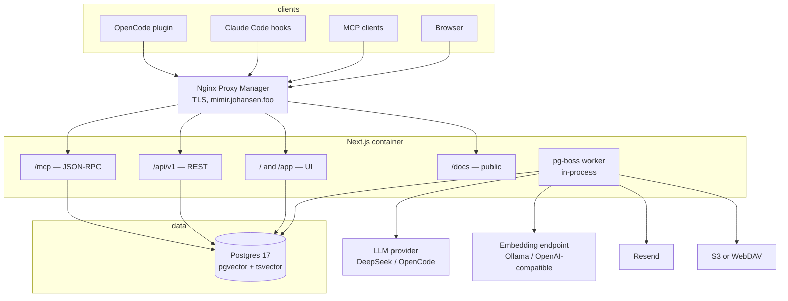
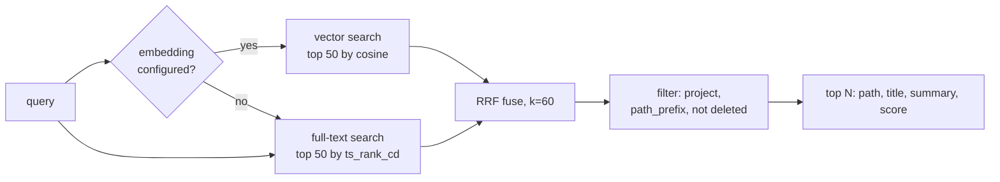
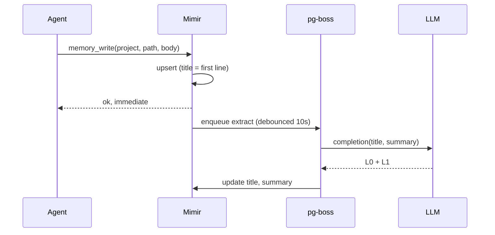
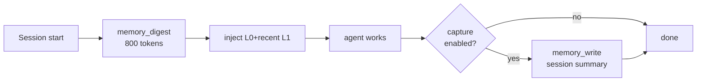

# Mimir — Design

**Date:** 2026-10-25
**Status:** Draft for approval
**Repo:** https://github.com/mojoaar/mimir
**License:** MIT

---

## 1. Intent

Mimir is long-term memory for coding agents, self-hosted. An agent — OpenCode, Claude Code, Codex, anything that speaks MCP — asks "what do we already know about this project?" and gets back the decisions, the conventions, the gotchas and the dead ends that were learned the hard way, scoped to the repo it is standing in.

The name is the product statement: Mímir's well holds wisdom, and Óðinn paid an eye for a drink. Memory is worth a price, and the price here is that every memory must be inspectable. Nothing is stored as an opaque embedding that a human cannot read, correct or delete.

### Why this exists

Two failure modes drove the design:

1. **Agents forget between sessions.** Every new session re-derives the same decisions, re-makes the same mistakes, and re-reads the same files. Context windows got bigger; they did not get persistent.
2. **Existing memory products are opaque.** A flat pile of extracted "facts" with no structure means retrieval pulls in authentication trivia while you are deploying, because nothing says which is which. The user cannot audit what was remembered, so they stop trusting it.

The answer is a memory that looks like a filesystem the agent already knows how to use (`tree`, `read`, `search`, `write`), with progressive detail (one line → one paragraph → full text) so an agent pays for a title until it needs a body.

### What success looks like

- A new agent session in an existing repo starts already knowing the project's conventions, without the user typing anything.
- A memory written in OpenCode is found by Claude Code the next day, in the same project, with no configuration.
- The admin can open a project, browse its memory as a file tree, and read exactly what the agents were told.
- The whole thing runs from one `docker compose up` on a homelab box and backs itself up nightly to S3 or pCloud.

---

## 2. Scope

### Goals (v1)

- Path-based memory store with L0/L1/L2 progressive detail.
- Hybrid retrieval: vector + full-text, fused, scoped by path prefix.
- MCP server over stateless JSON-RPC, plus a REST API with the same semantics.
- Multi-user: per-user projects, explicit read/write grants, admin-managed accounts.
- Password auth with TOTP MFA; sessions and API keys; optional IP allowlist.
- Per-user LLM provider configuration and an install-wide embedding model, with OpenCode Go and DeepSeek as first-class presets.
- Optional self-learning: title/summary extraction, and import of existing projects.
- Scheduled encrypted backups to S3-compatible storage or WebDAV (pCloud).
- Admin area: stats, users, memory browser, audit log, settings, backups.
- Four Rimfrost themes with light twins, `nordlys` default; responsive; SEO.
- i18n: English, Danish, German.
- Public docs site with per-agent MCP setup.

### Non-goals (v1)

- No hosted or paid tier. Self-host only.
- No billing, plans, quotas or metering.
- No Teams (schema is ready; see §7).
- No server-side repository cloning (the seam exists; see §11).
- No WebAuthn or SMS second factor.
- No memory versioning or diff history.
- No per-user custom domains.
- No Redis, no separate worker process, no microservices.
- No mobile app.
- No wiki or graph generation.

### Anti-goals

- **Not a chat product.** There is no conversation UI and no model to talk to.
- **Not a document RAG engine.** No PDF/Office ingestion. Memory is written by agents or imported from a repo as text.
- **Not an agent runtime.** Mimir never executes anything an agent asks it to.
- **Not a write-only log.** If a memory cannot be found again, storing it was pointless. Retrieval quality is the product; storage is plumbing.

---

## 3. Constraints

| Constraint | Consequence |
|---|---|
| Self-hosted on one homelab box behind a reverse proxy | One container, one process, one datastore. Boot-time migrations. No external queue. |
| Public URL is `https://mimir.johansen.foo` via Nginx Proxy Manager | TLS terminates at the proxy. App config carries an explicit public URL; forwarded headers trusted only from known proxies. |
| Public GitHub repo, MIT, GHCR images | No secrets in the repo. Multi-arch `amd64` + `arm64`. |
| Memory contains sensitive project detail | Encryption at rest for provider keys and TOTP secrets; encrypted backups; append-only audit. |
| Sole maintainer | Prefer boring, well-documented dependencies. Every extra service is a future outage. |
| Changelog + SemVer | Every user-visible change is a changelog entry; releases are tagged `vX.Y.Z`. |
| Rimfrost is a separate MIT repo | Its generated CSS is vendored as build input, not forked. |

---

## 4. Architecture

One Next.js application. The HTTP server, the MCP endpoint, the admin UI, the docs site and the background job worker all live in the same process.



### Stack

| Layer | Choice | Why |
|---|---|---|
| Framework | Next.js App Router, TypeScript, pinned major | UI, SEO, routing and API in one build. Upgrades get their own changelog entry. |
| Database | Postgres 17 + pgvector | Relational metadata, vectors and full-text in one store, so one backup story. |
| Jobs | pg-boss | Postgres-backed queue. No Redis, no second service. |
| Styling | Tailwind v4 + Rimfrost CSS variables | Tokens are plain CSS variables; Tailwind reads them natively. |
| i18n | next-intl | `localePrefix: 'as-needed'`. |
| Password hashing | `@node-rs/argon2` (argon2id) | Prebuilt musl binaries, no build toolchain in the image. |
| TOTP | `otpauth` | RFC 6238 verify + otpauth URI, no dependencies. |
| S3 client | `aws4fetch` | ~4 KB, signs any S3-compatible endpoint. The AWS SDK is not worth 10 MB. |
| WebDAV | plain `fetch` with `PROPFIND`/`PUT`/`DELETE` | pCloud's WebDAV surface needs no library. |
| Email | plain `fetch` to Resend | Ten lines instead of an SDK. |
| Encryption | `node:crypto` AES-256-GCM, HKDF from `MIMIR_SECRET` | No dependency, no key server. |

### Process model

- `instrumentation.ts` runs migrations, then starts pg-boss, inside the server process.
- One replica. If horizontal scaling is ever needed, the job worker becomes a second entrypoint from the same image (`node worker.js`) — the image already supports it.
- Boot sequence: acquire advisory lock → run pending SQL migrations → release → start pg-boss → serve.

### Module layout

Domain logic lives in plain TypeScript service modules. Route handlers and the MCP endpoint are thin adapters that parse input, call one service, and format output. This is the rule that keeps the project from becoming forty handlers each holding half a business rule.

```
app/
  (marketing)/[locale]/        landing pages
  (product)/app/               authenticated UI
  docs/                        public docs incl. per-agent pages
  api/v1/                      REST
  mcp/route.ts                 JSON-RPC endpoint
lib/
  db/          pool, transaction helper, migrations
  auth/        password, session, totp, api keys, rbac
  projects/    repo_key resolution, grants
  memory/      write, read, tree, search, extract, ingest
  providers/   llm, embeddings, presets, crypto
  backup/      dump, encrypt, s3, webdav, schedule
  audit/       writer, queries
  email/       resend client, templates
  settings/    typed getters, public URL resolution
  jobs/        pg-boss handlers
  mcp/         jsonrpc framing, tool definitions, auth
```

---

## 5. Data model

The installation **is** the tenant. There is no `tenant` table: one deployment serves one household or team, with per-user ownership inside it. Every table below is created in `public`, owned by a migration role, and accessed at runtime by a non-owner app role.

```sql
CREATE EXTENSION IF NOT EXISTS vector;

CREATE TYPE user_status AS ENUM ('pending', 'active', 'disabled');
CREATE TYPE user_role   AS ENUM ('admin', 'user');
CREATE TYPE grant_role  AS ENUM ('read', 'write');
CREATE TYPE principal   AS ENUM ('user', 'team');
CREATE TYPE token_kind  AS ENUM ('invite', 'password_reset', 'mfa_reset');
CREATE TYPE provider_kind AS ENUM ('llm', 'embedding');
CREATE TYPE backup_status AS ENUM ('running', 'ok', 'failed');
```

### users

```sql
CREATE TABLE users (
  id              uuid PRIMARY KEY DEFAULT gen_random_uuid(),
  email           citext UNIQUE NOT NULL,
  name            text NOT NULL DEFAULT '',
  password_hash   text,                    -- NULL until the invite is accepted
  status          user_status NOT NULL DEFAULT 'pending',
  role            user_role   NOT NULL DEFAULT 'user',
  locale          text        NOT NULL DEFAULT 'en',
  totp_secret_enc bytea,                   -- AES-GCM, NULL until MFA enrolled
  totp_last_step  bigint,                  -- replay guard
  failed_logins   int         NOT NULL DEFAULT 0,
  locked_until    timestamptz,
  created_at      timestamptz NOT NULL DEFAULT now(),
  updated_at      timestamptz NOT NULL DEFAULT now(),
  last_login_at   timestamptz
);
```

Only `active` users may authenticate. `disabled` also revokes sessions and API keys in the same transaction — otherwise disabling is decorative.

### sessions and api_keys

```sql
CREATE TABLE sessions (
  id          uuid PRIMARY KEY DEFAULT gen_random_uuid(),
  user_id     uuid NOT NULL REFERENCES users(id) ON DELETE CASCADE,
  token_hash  bytea NOT NULL UNIQUE,       -- SHA-256 of the cookie value
  ip          inet,
  user_agent  text,
  created_at  timestamptz NOT NULL DEFAULT now(),
  last_seen_at timestamptz NOT NULL DEFAULT now(),
  expires_at  timestamptz NOT NULL,
  revoked_at  timestamptz
);

CREATE TABLE api_keys (
  id           uuid PRIMARY KEY DEFAULT gen_random_uuid(),
  user_id      uuid NOT NULL REFERENCES users(id) ON DELETE CASCADE,
  name         text NOT NULL,
  prefix       text NOT NULL,              -- 'mimir_ab12cd34', shown in UI
  key_hash     bytea NOT NULL UNIQUE,      -- SHA-256, keys are 32 random bytes
  created_at   timestamptz NOT NULL DEFAULT now(),
  last_used_at timestamptz,
  revoked_at   timestamptz
);
```

API keys are hashed with SHA-256, not argon2: they are 256-bit random values, so there is nothing to brute-force, and the MCP path must stay fast.

### projects

```sql
CREATE TABLE projects (
  id                  uuid PRIMARY KEY DEFAULT gen_random_uuid(),
  owner_user_id       uuid NOT NULL REFERENCES users(id) ON DELETE CASCADE,
  name                text NOT NULL,
  slug                text NOT NULL,
  repo_key            text,                -- normalised git remote, sent by the client
  description         text NOT NULL DEFAULT '',
  llm_provider_id     uuid,                -- optional per-project override, FK added after §5 providers
  fts_language        text NOT NULL DEFAULT 'english',
  learning_enabled    boolean NOT NULL DEFAULT false,
  archived_at         timestamptz,
  created_at          timestamptz NOT NULL DEFAULT now(),
  updated_at          timestamptz NOT NULL DEFAULT now(),
  UNIQUE (owner_user_id, slug),
  UNIQUE (owner_user_id, repo_key)
);

CREATE TABLE project_grants (
  id             uuid PRIMARY KEY DEFAULT gen_random_uuid(),
  project_id     uuid NOT NULL REFERENCES projects(id) ON DELETE CASCADE,
  principal_type principal NOT NULL DEFAULT 'user',
  principal_id   uuid NOT NULL,
  role           grant_role NOT NULL DEFAULT 'read',
  created_by     uuid REFERENCES users(id) ON DELETE SET NULL,
  created_at     timestamptz NOT NULL DEFAULT now(),
  UNIQUE (project_id, principal_type, principal_id)
);
```

`principal_type` is an enum with `'team'` already present, and `principal_id` is a bare uuid rather than a foreign key. Adding Teams later means creating a `teams` table and writing grants with `principal_type='team'` — no schema migration of existing rows, no rewrite of the access predicate. That is the whole deferred cost.

`repo_key` is the normalised git remote (`host.tld/owner/repo`, lowercased, `.git` stripped, credentials removed), falling back to a hash of the canonical working directory for local-only repos. It is what makes an OpenCode session and a Claude Code session in the same checkout land in the same project with zero configuration.

**Project resolution for an agent, in order:** (1) explicit `project` argument; (2) a project where `repo_key` matches and the caller owns it or holds a grant; (3) create one owned by the caller. Step 2 is why a shared project is found before a duplicate is created.

### memories

```sql
CREATE TABLE memories (
  id           uuid PRIMARY KEY DEFAULT gen_random_uuid(),
  project_id   uuid NOT NULL REFERENCES projects(id) ON DELETE CASCADE,
  path         text NOT NULL,              -- 'auth/jwt/refresh-rotation'
  title        text NOT NULL DEFAULT '',   -- L0, one line
  summary      text,                       -- L1, one paragraph
  body         text NOT NULL,              -- L2
  tsv          tsvector,                   -- maintained by the service, project language
  embedding    vector(768),                -- dimension fixed install-wide, see §11
  kind         text NOT NULL DEFAULT 'note',   -- note | fact | decision | gotcha | snippet
  source       text NOT NULL DEFAULT 'agent',  -- agent | import | user | extracted
  author_user_id uuid REFERENCES users(id) ON DELETE SET NULL,
  metadata     jsonb NOT NULL DEFAULT '{}',
  deleted_at   timestamptz,                -- soft delete, purged after 30 days
  created_at   timestamptz NOT NULL DEFAULT now(),
  updated_at   timestamptz NOT NULL DEFAULT now()
);

CREATE UNIQUE INDEX memories_path_uniq ON memories (project_id, lower(path));
CREATE INDEX memories_embedding_idx ON memories
  USING hnsw (embedding vector_cosine_ops) WHERE deleted_at IS NULL;
CREATE INDEX memories_tsv_idx ON memories USING gin (tsv) WHERE deleted_at IS NULL;
CREATE INDEX memories_path_prefix ON memories (project_id, path text_pattern_ops);
```

**One embedding dimension per installation.** pgvector requires a fixed typmod to build an HNSW index, so the column carries `vector(768)` — the default for `nomic-embed-text` — and `settings.embedding_dim` must match it. Changing the embedding model means re-embedding every project, and if the dimension changes, a migration rewrites the column with `USING NULL` first. Per-project dimensions would need one partial expression index per dimension and a `dim` predicate in every query; that complexity buys nothing in a single-install homelab, so it is deferred, not designed away.

Paths are case-insensitive: stored lowercase, unique on `lower(path)`. Allowed characters `[a-z0-9._/-]` after normalisation, no leading or trailing slash, no `..`.

Bodies are capped at 256 KB, and an ingest batch at 100 files / 2 MB. Both are validated before the write, with a clear error rather than a truncated memory.

One path is one memory. Writes upsert. There are no `-2-final` variants, because the natural agent utterance is "update what we know about token rotation", not "append another fact about token rotation".

**Deletes are soft.** `deleted_at` is set, every read and search filters it out, and a nightly job purges rows older than 30 days. An agent that deletes the wrong path is recoverable from the UI within that window; without a tombstone the only recovery is a database restore, and memory is the product.

### providers

```sql
CREATE TABLE providers (
  id            uuid PRIMARY KEY DEFAULT gen_random_uuid(),
  user_id       uuid NOT NULL REFERENCES users(id) ON DELETE CASCADE,
  kind          provider_kind NOT NULL,
  preset        text NOT NULL,             -- opencode_go | opencode_console | deepseek | openai_compatible | ollama
  label         text NOT NULL,
  base_url      text NOT NULL,
  model         text NOT NULL,
  api_key_enc   bytea,
  api_key_hint  text,                      -- 'sk-…f3a2' for the UI
  dim           int,                       -- embedding only
  extra         jsonb NOT NULL DEFAULT '{}',
  is_default    boolean NOT NULL DEFAULT false,
  last_verified_at timestamptz,
  last_error    text,
  created_at    timestamptz NOT NULL DEFAULT now(),
  UNIQUE (user_id, kind, label)
);

CREATE UNIQUE INDEX providers_one_default ON providers (user_id, kind) WHERE is_default;
```

### tokens

One table for every single-use link. Invite, password reset and MFA reset all mint the same kind of token, so there is one mechanism to reason about rather than three.

```sql
CREATE TABLE tokens (
  id         uuid PRIMARY KEY DEFAULT gen_random_uuid(),
  user_id    uuid NOT NULL REFERENCES users(id) ON DELETE CASCADE,
  kind       token_kind NOT NULL,
  token_hash bytea NOT NULL UNIQUE,
  expires_at timestamptz NOT NULL,
  used_at    timestamptz,
  created_by uuid REFERENCES users(id) ON DELETE SET NULL,
  created_at timestamptz NOT NULL DEFAULT now()
);
```

### audit_log

```sql
CREATE TABLE audit_log (
  id          bigserial PRIMARY KEY,
  actor_type  text NOT NULL,               -- user | agent | system
  actor_id    uuid,
  action      text NOT NULL,               -- 'memory.write', 'auth.login', 'admin.user_verify'
  target_type text,
  target_id   text,
  detail      jsonb NOT NULL DEFAULT '{}',
  ip          inet,
  user_agent  text,
  created_at  timestamptz NOT NULL DEFAULT now()
);

CREATE INDEX audit_log_created_idx ON audit_log (created_at DESC);
CREATE INDEX audit_log_action_idx  ON audit_log (action, created_at DESC);
```

Append-only by two independent mechanisms: the app role is granted `INSERT, SELECT` only, and a `BEFORE UPDATE OR DELETE` trigger raises an exception. Either alone is too easy to undo by accident.

### backup_runs

```sql
CREATE TABLE backup_runs (
  id           uuid PRIMARY KEY DEFAULT gen_random_uuid(),
  started_at   timestamptz NOT NULL DEFAULT now(),
  finished_at  timestamptz,
  status       backup_status NOT NULL DEFAULT 'running',
  target       text NOT NULL,
  object_key   text,
  size_bytes   bigint,
  triggered_by text NOT NULL DEFAULT 'schedule',  -- schedule | manual
  error        text
);
```

### settings

```sql
CREATE TABLE settings (
  key        text PRIMARY KEY,
  value      jsonb NOT NULL,
  updated_at timestamptz NOT NULL DEFAULT now(),
  updated_by uuid REFERENCES users(id) ON DELETE SET NULL
);
```

Typed accessors live in `lib/settings/`, never raw lookups scattered through the code. Known keys: `public_url`, `site_name`, `meta_description`, `default_theme`, `require_mfa`, `embedding_provider_id`, `embedding_model`, `embedding_dim`, `ip_allowlist`, `learning_default`, `backup_schedule`, `backup_retain`, `backup_target`, `backup_credentials_enc`, `resend_from`, `resend_key_enc`, `mail_configured`.

---

## 6. Row-level security

Defence in depth, not the primary check. Every query also filters by ownership in the service layer; RLS catches the query somebody forgets.

```sql
-- Runtime connections are not the table owner.
ALTER TABLE projects       FORCE ROW LEVEL SECURITY;
ALTER TABLE memories       FORCE ROW LEVEL SECURITY;
ALTER TABLE project_grants FORCE ROW LEVEL SECURITY;
ALTER TABLE providers      FORCE ROW LEVEL SECURITY;

CREATE FUNCTION app_user_id() RETURNS uuid
LANGUAGE sql STABLE AS $$
  SELECT nullif(current_setting('mimir.user_id', true), '')::uuid
$$;

CREATE POLICY project_read ON projects FOR SELECT USING (
  owner_user_id = app_user_id()
  OR EXISTS (SELECT 1 FROM project_grants g
             WHERE g.project_id = projects.id
               AND g.principal_type = 'user'
               AND g.principal_id = app_user_id())
);
```

`sessions` and `api_keys` are deliberately **not** under RLS. Authenticating a request means resolving a token hash *before* any user id is known, so a policy keyed on `mimir.user_id` would match nothing. Both tables are looked up by an unguessable hash (`WHERE token_hash = $1 / key_hash = $1`) and expose no list endpoint to non-owners, so RLS adds no protection there — it only breaks login. `providers`, `projects`, `memories` and `project_grants` are forced.

Every request that touches those four runs inside a transaction that begins with `SET LOCAL mimir.user_id = $1`. `SET LOCAL` matters: the pool reuses connections, so a leaked session variable would hand one user's row visibility to the next request. The transaction helper in `lib/db/` is the only way to get a connection.

Job handlers set `mimir.user_id` to the project owner before touching memory, so background work is subject to the same rules as requests.

---

## 7. Tenancy and access

Ownership is per user. Sharing is per project, explicitly, with two roles.

| Actor | Can |
|---|---|
| Owner | everything, including deleting the project and changing its grants |
| `write` grant | read, write and delete memories; cannot change grants or delete the project |
| `read` grant | read, search, list; cannot write |
| Admin (role) | manage users and site settings; **not** read other users' memories |

That last row is deliberate. Being an admin is an operational role, not a licence to read everyone's project memory. An admin who needs access gets a normal grant, which is visible in the grants list and recorded in the audit log. Making admin an implicit superuser would make the audit log a lie.

Teams are not built. The schema absorbs them later at the cost of one table and one enum value already reserved.

---

## 8. Memory model

### Paths, not a filesystem

Directories are virtual, derived from `DISTINCT` prefixes of `path`. There is no folder table, no empty directories, no "parent must exist" rule. Moving a subtree is one statement:

```sql
UPDATE memories SET path = 'ops/' || substring(path from 5)
WHERE project_id = $1 AND path LIKE 'auth/%';
```

`ls` semantics survive because agents already know them, and because an agent that can guess the path can skip retrieval entirely (`memory_read('auth/jwt/refresh-rotation')` costs one call and no embedding).

### Three levels

| Level | Field | Length | Cost | Used when |
|---|---|---|---|---|
| L0 | `title` | one line | trivial | tree listings, search results |
| L1 | `summary` | one paragraph | small | deciding whether to read |
| L2 | `body` | unbounded | full | answering the question |

This is the whole trick behind paying 40 tokens to decide you do not need 4,000.

### Path conventions

Free-form, with a documented recommended shape. The store does not enforce structure beyond `[a-z0-9._/-]`, no leading or trailing slash, no `..`.

```
auth/jwt/refresh-rotation
deploy/homelab/compose-layout
decisions/2026-10-postgres-over-qdrant
gotchas/nextjs-cookies-in-middleware
conventions/commit-messages
```

### Degradation without a provider

No LLM configured means no extraction. Writes still succeed: `title` is the first non-empty line truncated to 120 characters, `summary` is `NULL`, and `read` returns the body. Search still works through full-text. A memory store that refuses to remember because billing lapsed is a bad memory store.

---

## 9. Retrieval



- **Vector arm:** `ORDER BY embedding <=> $1 LIMIT 50`, only rows with a non-null embedding.
- **Keyword arm:** `websearch_to_tsquery(project_language, $q)` against `tsv`, `ts_rank_cd` ordered.
- **Fusion:** Reciprocal Rank Fusion, `score = Σ 1/(60 + rank)`. RRF rather than score normalisation because cosine distance and `ts_rank_cd` are not on comparable scales and never will be.
- **Scoping:** `path_prefix` is applied as `path LIKE $prefix || '/%'`. Scoping is the feature that stops `auth/` from polluting `deploy/` — the single biggest failure mode of flat memory stores.
- **Results** return L0 and L1 only. Reading L2 is a separate call, and that is the point.
- **Query embedding** is computed per search when an embedding model is configured for the installation; otherwise the keyword arm runs alone. A provider timeout degrades to keyword search rather than failing the request.

---

## 10. Learning pipeline

Two jobs, both optional per project (`projects.learning_enabled`, default off), both run only when the project owner has an LLM provider configured.

**extract** — on memory write, debounced 10 s per project so a burst of writes is one call. Input: path, body. Output: `title` and `summary` (L0/L1). Does not touch the body. Cheap, one small completion.



The write never waits for the model. Extraction failure leaves the memory intact with a first-line title and a null summary — degraded, not lost.

**ingest** — bulk import of an existing project. Input: a batch of `{path, body}` pushed by the agent-side importer. Chunks, classifies and writes memories, then runs extract per memory. This is how "learn from existing projects" works without Mimir ever holding repository credentials.

The importer maps files to *semantic* memory paths (`conventions/state-management`, not `src/store/useAuth.ts`). Mimir is not a file mirror; storing a repository verbatim would trade a curated memory for a second, worse copy of the code.

**backfill** — embeds rows where `embedding IS NULL`, including rows written before an embedding provider was configured. This closes the gap between "project created by an agent before anyone set up Ollama" and "project that can be searched semantically".

**Consolidation** (merging near-duplicate paths, rewriting stale summaries) is deferred to v1.1. It needs disagreements about which memory wins, and that is a product decision best made after there is real data.

### Provider rules

| | Chosen by | Changes when |
|---|---|---|
| LLM (extraction) | project override → owner's default LLM → none | freely, per write |
| Embedding | installation-wide, set by an admin once | only by re-embedding every project |

Embeds are installation-wide because two models produce vectors in incompatible spaces. Mixing them does not error — cosine distance simply becomes meaningless and retrieval degrades silently. The extraction model is a preference; the embedding model is part of the schema.

Resolution for extraction, in order: `projects.llm_provider_id` if set, otherwise the project owner's provider where `is_default` is true, otherwise nothing happens and the memory keeps a first-line title. No cross-user fallback: a user's key is never spent on another user's content.

Changing the embedding model (or its dimension) runs **re-embed everything**: null all vectors, migrate the column if the dimension changed, re-embed in batches, then verify that no live row is missing a vector. This must exist before v1 — without it a project quietly stops retrieving and nobody notices until the memory is useless.

### Job inventory

| Job | Trigger | Purpose |
|---|---|---|
| `extract` | on write, debounced 10 s per project | generate L0 title and L1 summary |
| `ingest` | `memory_ingest` call | chunk an imported batch into memories, then extract each |
| `backfill` | embedding configured, or memory written without one | embed rows where `embedding IS NULL` |
| `reembed` | admin changes the embedding model | null, re-embed, verify |
| `purge` | nightly | hard-delete rows whose `deleted_at` is older than 30 days |
| `prune-audit` | nightly | apply per-class retention (§19) |
| `backup` | schedule | §18 |

---

## 11. Providers

Per user. Each user configures their own keys; no user sees another's. Keys are AES-256-GCM encrypted with a key derived from `MIMIR_SECRET`, masked in the UI after save (`api_key_hint`), and redacted from logs and audit detail.

Anonymous, non-consuming work uses the LLM of the **project owner**, because the owner of the data decides where it goes and pays for it.

### First-class presets

| Preset | Base URL | Protocol |
|---|---|---|
| `deepseek` | `https://api.deepseek.com` | OpenAI chat completions |
| `opencode_go` | `https://opencode.ai/inference/go` | OpenAI chat completions |
| `opencode_console` | `https://opencode.ai/inference` | OpenAI chat completions |
| `ollama` | `http://host.docker.internal:11434` | OpenAI chat completions + embeddings |
| `openai_compatible` | anything | OpenAI chat completions + embeddings |

One HTTP client, one request shape. Adding a provider is a row, not code.

**Only the OpenAI-compatible surface is implemented.** OpenCode Go also serves models over the Responses, Anthropic Messages and Google shapes; those cover Claude, Gemini and GPT-Luna. They are out of scope for v1 because the OpenAI-compatible subset already includes DeepSeek V4.1 Flash, GLM, Kimi and Qwen3.8 Flash — everything extraction needs.

Each provider row carries `is_default`, and at most one row per `(user_id, kind)` may have it true (enforced by a partial unique index). The resolver in §10 reads it; a project can override the LLM but never the embedding model.

### Embeddings

DeepSeek has no embeddings endpoint. Embeddings therefore need their own provider, and the documented homelab default is Ollama with `nomic-embed-text` (768 dimensions).

**The embedding model is configured once for the whole installation**, by an admin, in `settings.embedding_provider_id` / `embedding_model` / `embedding_dim`. The provider row belongs to that admin; the setting makes it usable for every project regardless of owner, which is the one deliberate exception to "a user's key is never used for another user's content" — and it exists because embeddings are a shared index, not an egress decision. It is not per user and not per project. One model means one comparable vector space, one HNSW index, and one place to change it. If the model or its dimension changes, the admin runs re-embed everything (§10) and the column is migrated to the new dimension.

Three deployment shapes, one setting:

| Ollama runs | Base URL |
|---|---|
| On the host, Mimir in Docker | `http://host.docker.internal:11434` |
| As a compose sidecar | `http://ollama:11434` |
| Remote | `https://…` |

Ollama binds to `127.0.0.1` by default, so the host case requires `OLLAMA_HOST=0.0.0.0`. This goes in the docs next to the field, because it is the most common way the setup fails.

Every provider form has **Test connection**, which calls `/v1/models` (or `/v1/embeddings` with a one-word input), reports the outcome, and stores `last_verified_at` / `last_error`.

### Writes never block on providers

The write path stores text and metadata always. If a provider is configured, the vector is computed on write; if not, it stays null and a backfill job fills it later. A broken provider degrades to keyword search instead of rejecting writes.

### OpenCode Go specifics

- Send `x-opencode-session` (stable per tenant per batch) and a Mimir-specific `User-Agent`. Go's terms ask clients to identify themselves.
- Quota for the admin dashboard: `GET https://opencode.ai/zen/go/v1/usage` → rolling (≈5 h), weekly, monthly, each with `percent` used and `resetsAt`. Poll no more than every 5 minutes.
- Verify available models at connect time (`GET /inference/go/v1/models`) instead of trusting a hardcoded list; Go moves models between protocol shapes.
- Go's terms describe the traffic as coding-agent traffic. Background extraction is adjacent but not identical, so DeepSeek direct is the default preset for extraction and Go is offered because users will already have it.

---

## 12. Authentication and accounts

### Bootstrap

`MIMIR_ADMIN_EMAIL` and `MIMIR_ADMIN_PASSWORD` create the first admin on boot, **only** when the `users` table is empty. The guard runs once and never again, so a stale compose file cannot resurrect or overwrite an account. The password is hashed with argon2id like any other; the env var is plaintext in compose, which is stated plainly in the deploy docs.

### Users

| Status | Can log in |
|---|---|
| `pending` | no |
| `active` | yes |
| `disabled` | no |

Invite → user sets a password → `pending` → admin verifies → `active`. Admin-created users start `active`.

Invites, password resets and MFA resets all mint a row in `tokens` (hashed, one hour, single use). With Resend configured the link is emailed; without it the admin gets a copyable link. One mechanism, two delivery paths.

### Sessions and keys

- Session cookie: `__Host-mimir_session`, `HttpOnly`, `Secure`, `SameSite=Lax`, 30 days, sliding `last_seen_at`.
- API key: `mimir_` + 32 random bytes base62, SHA-256 at rest, shown once.
- Disabling a user revokes all sessions and API keys in the same transaction.

### MFA

TOTP only. **Optional per user**, with an installation switch: `settings.require_mfa`. When it is on, any unenrolled user is forced through enrollment at next login; when off, MFA is a setting each user may enable.

Enrollment shows an otpauth URI as a QR code, confirms one code, then stores the secret encrypted. Verification accepts ±1 time step and rejects a step already used (`totp_last_step`), so a captured code cannot be replayed inside its window.

Recovery: **admin reset MFA** clears `totp_secret_enc` and revokes that user's sessions. Under `require_mfa` the user is pushed straight back into enrollment; otherwise MFA is simply off for them. No recovery codes in v1 — with Resend unconfigured, the admin is the only recovery path, and that is what the button is for. The bootstrap admin from env vars starts unenrolled even when `require_mfa` is on, so a misconfigured install cannot lock its only admin out.

### Optional IP allowlist

`settings.ip_allowlist`: list of CIDR blocks. Empty means no restriction. When non-empty, every request from outside the list is rejected before routing, except `/health`.

Behind a reverse proxy the client IP comes from `X-Forwarded-For`, which is trivially forged. The header is trusted **only** when the peer address is in `MIMIR_TRUSTED_PROXIES`; otherwise the socket address is used. This applies to the allowlist, the audit log and login rate limiting alike.

### Rate limiting

In-process sliding window, keyed by IP and by account: login 5 attempts / 15 min, then lock; MCP and API 60 requests / min per key. In-memory is sufficient because there is exactly one process; a second replica requires moving this to Postgres, which is a known follow-up.

### CSRF

Server actions rely on Next's built-in origin check against the public URL. The REST and MCP surfaces are cookie-free and require `Authorization: Bearer`, so they are not CSRF-able.

---

## 13. MCP surface

Transport: `POST /mcp`, JSON-RPC 2.0, stateless. No SSE. `GET /mcp` returns 405. Stateless is not a shortcut — it is what lets Mimir sit behind a stock Nginx Proxy Manager without buffering configuration, and what makes a restart invisible to clients.

Auth: `Authorization: Bearer mimir_…`. Every call is audited as one row, because the *fact* of querying memory about a project is itself sensitive.

| Tool | Arguments | Returns |
|---|---|---|
| `memory_tree` | `project?`, `repo?`, `path?`, `depth?` | `[{path, title, has_summary, updated_at}]` — L0 only |
| `memory_read` | `project?`, `repo?`, `path`, `depth?` | `{path, title, summary, body}` |
| `memory_search` | `project?`, `repo?`, `query`, `path_prefix?`, `limit?` | `[{path, title, summary, score}]` |
| `memory_digest` | `project?`, `repo?`, `budget_tokens?` | `{text, memory_count, truncated}` — the session-start digest |
| `memory_write` | `project?`, `repo?`, `path`, `body`, `title?`, `kind?` | `{path, created: bool}` |
| `memory_delete` | `project?`, `repo?`, `path` | `{deleted: bool}` |
| `memory_ingest` | `project?`, `repo?`, `files: [{path, body}]` | `{accepted, queued}` |
| `project_list` | — | `[{slug, name, role, memory_count}]` |

`project` and `repo` are optional and mutually exclusive in practice. **The client computes `repo_key`**, because a remote server never sees the client's working directory: the plugin runs `git remote get-url origin`, normalises it (`host.tld/owner/repo`, lowercase, `.git` stripped, credentials stripped, `https`/`ssh`/`git` unified), and sends it as the `repo` argument or the `X-Mimir-Repo` header. For a repository with no remote it sends `local:<sha256 of the absolute path>` — honest about the fact that a local-only repo cannot be matched across machines.

Clients without a plugin (Tier 3) pass `project` explicitly, or implement the same two-line normalisation themselves. Zero configuration is a property of the plugin, not of the protocol, and the docs say so.

`memory_digest` exists because session-start injection needs a deterministic selection, not a query: an agent opening a session has no search terms yet. It returns L0 titles for the most recently updated memories plus the full L1 for the five most recent, grouped by top-level directory, packed into 800 tokens by default. No LLM, no embedding, one indexed read.

Tools only. MCP resources and prompts are not implemented: resources duplicate `memory_read`, and prompts are not memory.

Errors: JSON-RPC error objects with a stable `data.code` (`not_found`, `forbidden`, `invalid_path`, `dimension_mismatch`, `rate_limited`). A `forbidden` never reveals whether the path exists in someone else's project.

---

## 14. Agent support

Mirror the Superpowers pattern: one portable instruction core, plus per-harness adapters. Docs emit the correct file and format for each harness — this is the gap worth closing, since most tools document one generic JSON snippet and leave users to guess.

| Tier | Harness | Integration |
|---|---|---|
| 1 | OpenCode | Real plugin: registers MCP, injects a memory digest at session start, `/mimir` commands, opt-in capture at session end |
| 1 | Claude Code | `.mcp.json` + `CLAUDE.md` block + `SessionStart` / `Stop` hooks |
| 2 | Codex | `~/.codex/config.toml` `[mcp_servers.mimir]` + `AGENTS.md` |
| 2 | Cursor | `mcpServers` + rules file |
| 2 | Gemini CLI | `settings.json` + hierarchical `GEMINI.md` |
| 2 | Pi, Antigravity, Hermes, Muse | MCP config + instruction block |
| 3 | Anything else | raw JSON-RPC against `/mcp` |

Default behaviour: **auto-inject on, auto-capture off.** Injection is one scoped search per session start and is the reason the product is useful. Capture is opt-in per project, because otherwise every conversation spends extraction tokens and fills memory with noise nobody asked to keep.



---

## 15. HTTP API

`/api/v1`, Bearer auth, JSON in and out. Mirrors the MCP tools one-to-one so there is one mental model:

```
GET    /api/v1/projects
GET    /api/v1/projects/:slug/tree?path=
GET    /api/v1/projects/:slug/memory/:path
PUT    /api/v1/projects/:slug/memory/:path
DELETE /api/v1/projects/:slug/memory/:path
POST   /api/v1/projects/:slug/search
GET    /api/v1/projects/:slug/digest?budget_tokens=
POST   /api/v1/projects/:slug/ingest
GET    /api/v1/me
GET    /api/v1/health                  (public: {status}; authenticated: details)
```

Anything the MCP surface can do, a shell script can do with `curl`. The docs show both for every endpoint.

---

## 16. i18n

`en` (default, no prefix), `da`, `de`. `localePrefix: 'as-needed'`.

- Resolution: cookie → `Accept-Language` → `en`.
- Missing keys fall back to English and log in development, so a forgotten string is a visible bug rather than `user.verify.title` in the interface.
- Marketing pages get `hreflang` alternates and a per-locale sitemap; that is where i18n earns its keep for SEO.
- Emails are localized from `users.locale`, set at invite time, using the same message catalog as the UI.
- **Docs stay English.** API examples and per-agent config snippets would otherwise be maintained three times forever, and nobody reads `.mcp.json` instructions in German.
- `/api` and `/mcp` sit outside the locale tree.

---

## 17. UI, theming and SEO

### Themes

Rimfrost's generated CSS is vendored at build time into `styles/tokens/`, not forked. Eight values: `fjord`, `nordlys`, `ravn`, `skumring` and each one's `-light` twin. Default `nordlys`, per the brief.

Theme is a cookie resolved server-side so the first paint is correct — no flash, no `useEffect` swap. The switcher writes the cookie and updates `data-theme` on `<html>`; `<meta name="theme-color">` follows the computed `--bg`.

Because the tokens are plain CSS variables, every surface — marketing, product, docs, code blocks — themes consistently, including Rimfrost's contrast-tested syntax colors.

### Pages

```
/                  marketing (indexable, 3 locales)
/docs              public docs, English
/docs/agents/:name per-harness setup (indexable — long-tail search)
/login, /mfa
/app                   dashboard
/app/projects/:slug    memory file browser
/app/projects/:slug/settings   project settings + grants
/app/settings          per-user: profile, password, MFA, API keys, providers, sessions, locale
/app/admin/users       admin only
/app/admin/audit       admin only
/app/admin/settings    admin only — public URL, site meta, embedding model, IP allowlist, MFA policy
/app/admin/backups     admin only
```

`/app/settings` is **every user's** page, not an admin one: providers, API keys, MFA and session revocation are per-user, and putting them behind the admin gate would leave normal users unable to configure the provider that makes their own memory searchable. Admin surfaces live under `/app/admin/*` and are gated by `role = 'admin'` in middleware and in every server action.

The memory browser is a file tree on the left and L0/L1/L2 on the right. It exists because debugging a memory store through SQL is miserable, and because "show me exactly what my agents were told" is the trust feature.

### SEO

- Canonical URLs derived from `settings.public_url`, never from request headers.
- `sitemap.xml` per locale; `robots.txt` disallows `/app`, `/api`, `/mcp`.
- Product routes send `X-Robots-Tag: noindex`.
- One static OG image per locale plus per-agent docs pages.
- Marketing copy is server-rendered, not client-fetched.

### Public URL is a setting

`settings.public_url`, admin-editable, resolution order: database → `MIMIR_PUBLIC_URL` env (bootstrap seed) → `http://localhost:3000` in development.

Everything reads it through `getPublicUrl()`: canonical tags, sitemap, `hreflang`, OG URLs, invite and reset links, the TOTP issuer, and CSRF origin checks.

A middleware 301 redirects any other host to the canonical one, so moving domains leaves the old host working as a redirect instead of serving a second indexable copy. Exempt `/health` and non-DNS hosts.

Two consequences shown in the confirm dialog: moving domains logs everyone out (cookies are host-scoped), and old emailed links only keep working if the old domain still points at the box.

Validation: origin only, no path, no trailing slash, `https` required in production as a warning rather than a block.

---

## 18. Backups

Nightly by default, cron expression in `settings.backup_schedule`. Each run produces two artifacts:

| Artifact | Contents |
|---|---|
| `mimir-YYYYMMDD-HHMMSS.dump.enc` | `pg_dump -Fc` of the whole database, including vectors |
| `settings-YYYYMMDD-HHMMSS.json.enc` | `settings`, project metadata, provider labels — no secrets, no memory bodies |

Settings are exported separately so a new install can be configured from a backup without restoring user data.

- **Encryption:** AES-256-GCM, key derived via HKDF from `MIMIR_SECRET` (`info="backup"`). Nonce and tag are stored in the object header. A backup on someone else's cloud is ciphertext.
- **Targets:** S3-compatible via `aws4fetch` (path-style option for MinIO), or WebDAV via `PUT` against pCloud (`https://webdav.pcloud.com`).
- **Verification:** after upload, `HEAD` the object and compare size. A backup that was never verified is a hope.
- **Retention:** keep the newest N (default 14), delete older objects under the configured prefix only.
- **Failure:** records `backup_runs.status = 'failed'` with the error, writes an audit row, and emails the admin if Resend is configured. The dashboard shows the last successful run and turns red past the interval.
- **Restore:** documented, not a button. `scripts/restore.sh` decrypts and pipes into `pg_restore`. Restoring over a live database from a web form is how people lose data.

Because `MIMIR_SECRET` keys both provider credentials and backups, losing it is total loss of both — and generating it silently would put the key that decrypts a backup inside the same install that produces it. So it is **never auto-generated**. First boot without `MIMIR_SECRET` fails with a message telling the operator to run `openssl rand -hex 32` and store the value outside compose. A restart that invents a new key would otherwise make every stored provider credential and every existing backup permanently unreadable, silently.

Backup target credentials are encrypted with the same helper as provider keys before they touch `settings`. WebDAV passwords and S3 secret keys are secrets whether or not they look like it.

---

## 19. Audit

One row per MCP or API call, not per memory touched — a read of fifty memories is one act of reading.

Actions are namespaced: `auth.login`, `auth.failed`, `auth.mfa`, `memory.read`, `memory.write`, `memory.delete`, `project.grant`, `admin.user_verify`, `admin.user_disable`, `admin.user_create`, `admin.password_reset`, `admin.role_change`, `admin.settings_change`, `backup.run`, `provider.update`.

`detail` never contains a secret or a memory body. It holds counts, paths, and durations.

Admin page is read-only with filters (actor, action, date, text) and CSV export. Retention is per class: reads age out at about 30 days, auth and admin events are kept for a year. A nightly prune job enforces it. Read rows will vastly outnumber memory rows, so the prune is not optional.

---

## 20. Deployment

```yaml
services:
  db:
    image: pgvector/pgvector:pg17
    volumes: [pgdata:/var/lib/postgresql/data]
    healthcheck: pg_isready
  mimir:
    image: ghcr.io/mojoaar/mimir:0.1.0
    ports: ["127.0.0.1:3000:3000"]
    environment:
      MIMIR_PUBLIC_URL: https://mimir.johansen.foo
      MIMIR_SECRET: ${MIMIR_SECRET}          # required, never auto-generated
      MIMIR_ADMIN_EMAIL: ${ADMIN_EMAIL}
      MIMIR_ADMIN_PASSWORD: ${ADMIN_PASSWORD}
      MIMIR_TRUSTED_PROXIES: ${NPM_IP}
      DATABASE_URL: postgres://mimir_app:…@db:5432/mimir
      DATABASE_ADMIN_URL: postgres://mimir_owner:…@db:5432/mimir
    depends_on: { db: { condition: service_healthy } }
  ollama:
    profiles: ["ollama"]
    image: ollama/ollama
    volumes: [ollama:/root/.ollama]
```

### Database roles

Two roles, because RLS is decorative if the application connects as the table owner:

| Role | Used by | Rights |
|---|---|---|
| `mimir_owner` | migrations, `pg_dump`, pg-boss schema setup | owns all tables, bypasses RLS |
| `mimir_app` | the runtime connection | `SELECT/INSERT/UPDATE/DELETE` on data, `INSERT/SELECT` only on `audit_log`, no DDL |

Both are created by an init SQL mounted into the Postgres container's `/docker-entrypoint-initdb.d/`, so `docker compose up` on a fresh volume produces a working pair with no manual step. The app therefore needs two connection strings: `DATABASE_URL` (runtime) and `DATABASE_ADMIN_URL` (boot-time migrations and the backup job). pg-boss runs its own DDL, so its schema is created with the admin connection at boot before jobs start.

- Port bound to loopback; Nginx Proxy Manager forwards from the host or the shared docker network. Nothing else is published.
- Image: multi-stage, `node:22-alpine`, Next standalone output, non-root user, `postgresql-client-17` installed for `pg_dump`. Both `amd64` and `arm64`.
- `/health` returns `{status}` anonymously and full detail when authenticated.
- Migrations run at boot under a Postgres advisory lock, so a restart mid-upgrade is safe.

### Release process

- `CHANGELOG.md` in Keep a Changelog format; entries are written in the PR that makes the change, under `Unreleased`.
- SemVer. Before 1.0, breaking changes bump the minor and are marked `BREAKING`. After 1.0, they bump the major.
- Tag `vX.Y.Z` → GitHub Action builds both architectures, pushes to `ghcr.io/mojoaar/mimir`, cuts a GitHub release from the changelog section.
- Suggested first bumps: `0.1.0` when it boots, authenticates and stores + retrieves memory through MCP; `0.2.0` when backups, admin and i18n land; `1.0.0` when the schema is declared stable.

---

## 21. Security posture

| Area | Decision |
|---|---|
| Passwords | argon2id, memory cost tuned for a homelab (64 MiB, t=3, p=1) |
| At rest | provider keys and TOTP secrets AES-256-GCM under HKDF(`MIMIR_SECRET`) |
| Transport | TLS at the proxy; `Secure` cookies; HSTS at the proxy |
| Sessions | hashed tokens, `__Host-` cookie, revocable, revoked on disable |
| API keys | SHA-256 at rest, prefix shown in UI, revocable |
| MFA | TOTP with replay guard; admin reset as recovery |
| Admin boundary | admins cannot read user memories without an explicit grant |
| Audit | append-only by grant and trigger |
| Backups | encrypted before leaving the box |
| Trusted proxies | `X-Forwarded-For` honoured only from configured peers |
| Secrets in logs | redaction helper on every log site that touches config |

Threat model in scope: a curious other user on the same install, a stolen API key, a compromised backup target, and a stranger on the network. Out of scope: a hostile host administrator, and supply-chain compromise of npm.

---

## 22. What the builder decides

Left open deliberately, because a sensible builder can settle these without changing what gets built:

- Exact Tailwind configuration and component decomposition.
- Test framework and coverage targets (Vitest + Playwright assumed).
- Whether the docs site is one long page per locale or split by section.
- Marker conventions for the agent importer (which files are worth importing).
- Precise argon2 parameters.
- Component library: hand-rolled or a headless primitive library.
- Chart library for the admin stats page.

## 23. Deferred

| Item | Why deferred | Cost to add later |
|---|---|---|
| Teams | One user today | One table + one enum value already reserved |
| Server-side repo cloning | Agent-side import needs no credentials | A `git clone` caller of the existing `ingestProject()` |
| Consolidation job | Needs real data to choose a merge policy | New job over existing schema |
| Memory versioning | Audit records writes, not bodies | Add `memory_versions` |
| WebAuthn | TOTP covers the requirement | New authenticator table + credential flow |
| Responses / Anthropic / Google provider shapes | OpenAI subset covers the models that matter | One adapter each, behind the same interface |
| Hosted tier | Explicitly out of scope at launch | Substantial: billing, isolation, limits |
| Per-user custom domains | One canonical URL per install | Host-based routing in middleware |
| Per-project embedding models | One model per install keeps vectors comparable and the index simple | Partial expression index per dimension + a `dim` predicate |
| OpenCode plugin as a separate package | A monorepo package (`packages/opencode-plugin`) published to npm on its own version | Already structured for it; extraction is a directory move |
